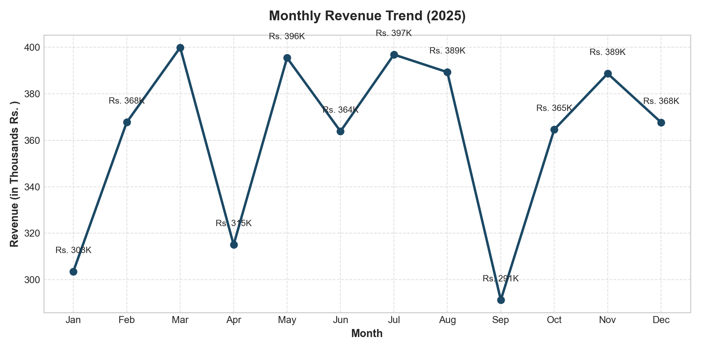
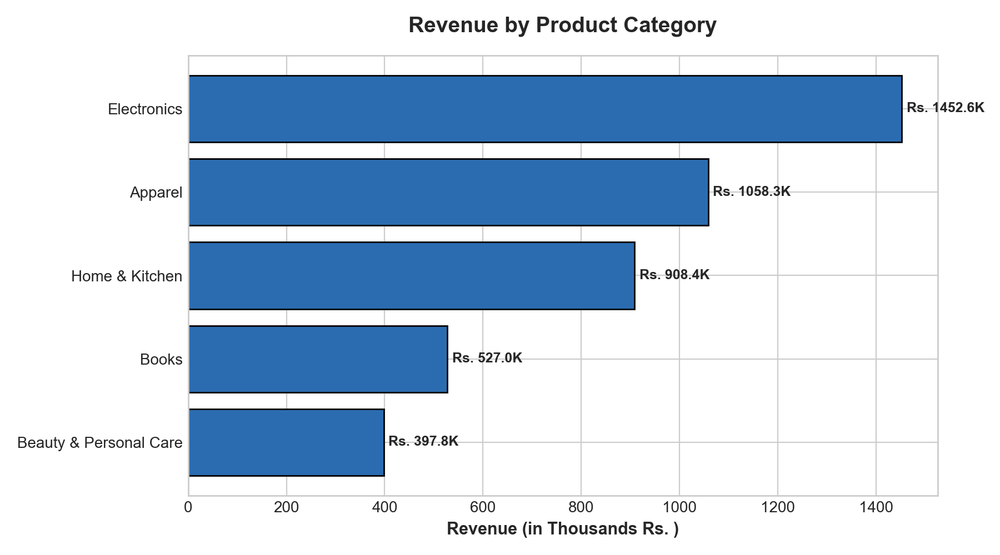
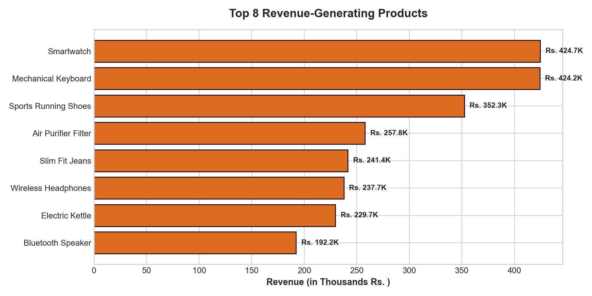
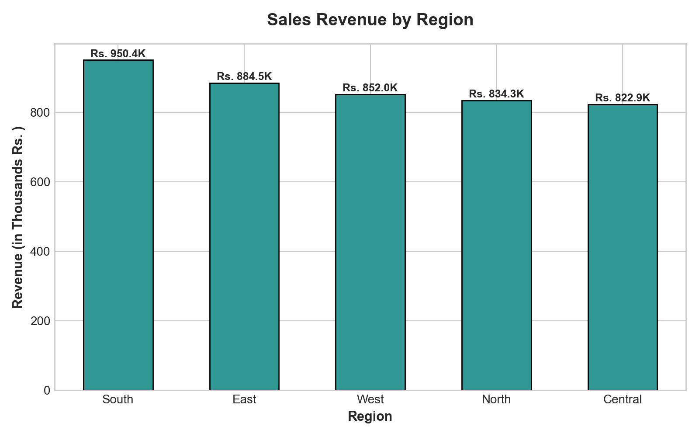

# Retail Sales & Customer Performance Analysis

A comprehensive Data Analytics project analyzing retail transaction data to evaluate monthly revenue trends, product category performance, regional sales distribution, and customer purchasing patterns.

---

## 📌 Project Overview
In retail businesses, transaction volumes can be massive and distributed across multiple territories and product categories. Understanding sales velocity, seasonal demand variations, and customer repeat purchase behaviors is critical for inventory planning and promotional strategy.

This project covers the full data analysis workflow:
1. **Data Cleaning & Preprocessing:** Data type casting, handling missing values, date feature engineering using **Python (Pandas)**.
2. **Exploratory Data Analysis & Visualization:** Generating trend lines, category distributions, and regional metrics using **Matplotlib**.
3. **Database Querying & Analysis:** Structuring relational schemas and writing business intelligence queries using **SQL**.
4. **Business Reporting:** Preparing executive pivot tables and summaries in **Microsoft Excel**.

---

## 🛠️ Tech Stack & Tools
- **Language:** Python 3.x
- **Libraries:** Pandas, NumPy, Matplotlib
- **Database:** SQL (MySQL / SQLite / PostgreSQL compatible)
- **Spreadsheet:** Microsoft Excel
- **Environment:** Jupyter Notebook / VS Code

---

## 📁 Repository Structure
```text
├── data/
│   └── retail_sales_data.csv               # 2,500 retail transaction records
├── scripts/
│   └── retail_sales_analysis.py            # Complete Python analysis & chart generation script
├── sql/
│   └── schema_and_queries.sql              # Database schema & 7 analytical business queries
├── visualizations/
│   ├── monthly_sales_trend.png             # Monthly revenue progression chart
│   ├── category_revenue_distribution.png   # Revenue by category breakdown
│   ├── regional_sales_performance.png      # Regional comparison chart
│   └── top_products_bar_chart.png          # Top 8 highest-earning product SKUs
├── reports/
│   └── Retail_Sales_Summary_Report.xlsx    # Multi-tab Excel summary with pivot tables & KPIs
├── Retail_Sales_Analysis.ipynb             # Interactive Jupyter Notebook
├── .gitignore                              # Git exclusion rules
└── README.md                               # Project documentation
```

---

## 📊 Key Findings & Business Insights

| Metric | Analyzed Value |
| :--- | :--- |
| **Total Revenue** | **₹43,44,136.65** |
| **Total Orders** | **2,500** |
| **Total Units Sold** | **4,513** |
| **Average Order Value (AOV)** | **₹1,737.65** |

### 1. Monthly Revenue Trend
Sales showed steady consistency throughout the year with clear mid-year and festive quarter demand increases.



---

### 2. Category Performance
- **Electronics** was the highest grossing category, accounting for **33.44% (₹14.52 Lakhs)** of total revenue, driven by higher average unit prices.
- **Apparel** followed at **24.36% (₹10.58 Lakhs)**.
- **Home & Kitchen** and **Books** drove the highest order volume (~520+ transactions each), demonstrating strong everyday customer engagement.



---

### 3. Top-Performing Products
High-margin consumer electronics led the top product rankings, with Smartwatches and Mechanical Keyboards generating the largest revenue shares.



---

### 4. Regional Distribution
Sales volume was balanced across North, South, East, West, and Central India, indicating consistent regional adoption across diverse customer segments.



---

## 🗄️ SQL Business Queries
The project includes 7 structured SQL queries covering:
1. Overall revenue, order volume, and AOV calculations.
2. Monthly revenue trends and order counts.
3. Category revenue contribution and percentage share.
4. Top 10 best-selling products by total revenue.
5. Regional customer penetration and territorial sales volume.
6. Customer lifetime value (CLV) and repeat buyer identification (`HAVING COUNT(Order_ID) >= 5`).
7. Payment method distribution (Credit Card, UPI, Net Banking, COD).

All queries are documented in [`sql/schema_and_queries.sql`](sql/schema_and_queries.sql).

---

## 💻 How to Run

1. **Clone the repository:**
   ```bash
   git clone https://github.com/bablirawat/retail-sales-analysis.git
   cd retail-sales-analysis
   ```

2. **Install required dependencies:**
   ```bash
   pip install pandas numpy matplotlib openpyxl
   ```

3. **Run the Python analysis:**
   ```bash
   python scripts/retail_sales_analysis.py
   ```

4. **Explore the Jupyter Notebook:**
   Open `Retail_Sales_Analysis.ipynb` in VS Code or Jupyter Lab to run cell-by-cell.

---

## 👤 Author
**Babli**  
- LinkedIn: [linkedin.com/in/babli-rawat-57a7742b5](https://www.linkedin.com/in/babli-rawat-57a7742b5/)  
- GitHub: [github.com/bablirawat](https://github.com/bablirawat)
